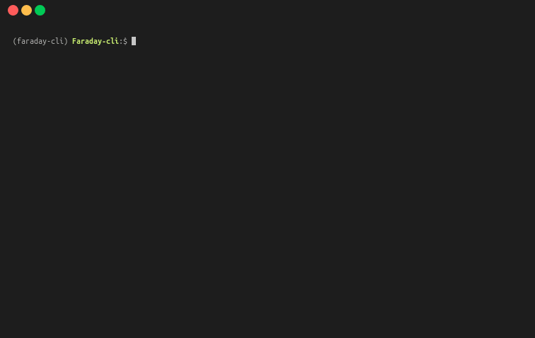
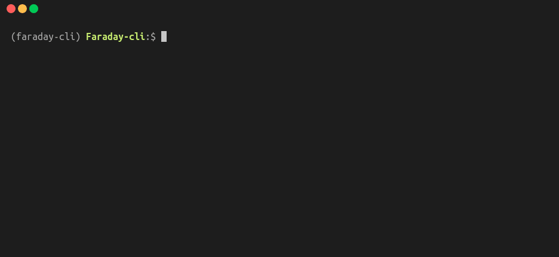
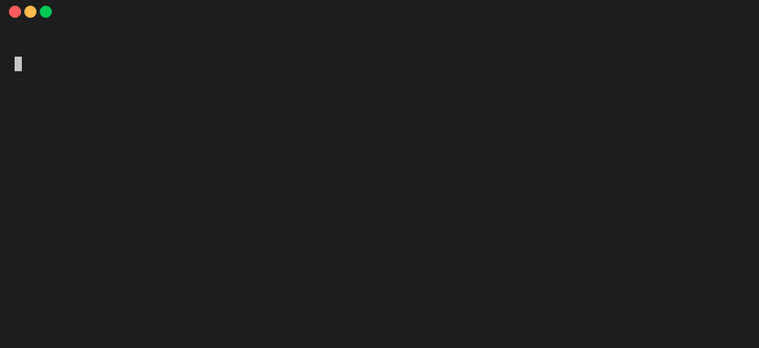
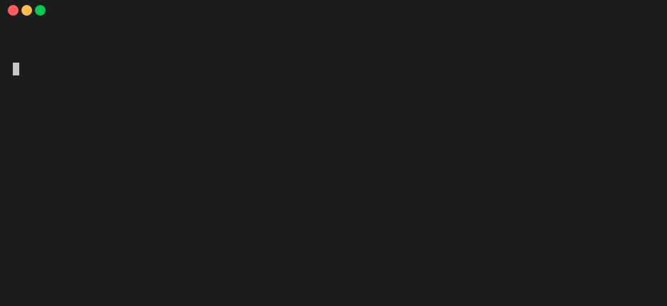

# Faraday on the terminal
Use faraday directly from your favorite terminal



faraday-cli is the official client that makes automating your security workflows easier.

## Features

- **Two ways to use it** — an interactive shell or single commands for scripts and pipelines
- **Import tool output** — process reports from 100+ security tools ([Faraday Plugins](https://github.com/infobyte/faraday_plugins)), or run a supported tool and upload its results automatically
- **Workspaces, hosts, services and vulnerabilities** — list, create, update and delete them, with stats and a workspaces dashboard
- **AI pentests with FaradAI** — launch FaradAI scans and triage from the terminal, including self-registration on the FaradAI-scan SaaS
- **Agents and scanners** — run local Faraday Agents (runners) and server-side cloud agents (scanners)
- **Several servers** — saved connection sessions to switch between servers or users
- **Executive reports** — generate them from your templates (commercial versions of Faraday)

Before installing, we recommend creating and activating a Python virtual environment to avoid affecting your system Python packages. For example:

```shell
python3 -m venv .venv
source .venv/bin/activate
```

You can also use `virtualenv` if you prefer. Once the virtual environment is active, run the installation commands below.

## Install from pip

```
pip install faraday-cli
```

## Install from source
```shell script
git clone https://github.com/infobyte/faraday-cli.git
cd faraday-cli
pip install .
```

## Documentation

For more info you can check our [documentation][doc]. From the CLI itself,
`faraday-cli --help` shows the common commands and `faraday-cli <command> -h`
the options of any command.


## Use it like a command

### Login

Configure auth for faraday-cli

```shell script
$ faraday-cli auth
```


Each login is saved as a named session (`user@host`), so you can keep several
servers or users and switch between them:

```shell script
$ faraday-cli auth list
  ID  ACTIVE    NAME                       KIND    SERVER                        USER     WORKSPACE
----  --------  -------------------------  ------  ----------------------------  -------  -----------
   1  ✔         alice@faraday.example.com  server  https://faraday.example.com/  alice    some_name
   2            faraday@localhost          server  http://localhost:5985         faraday  -

$ faraday-cli auth use 2
$ faraday-cli status
```


### Create a workspace
When you create a workspace by default is selected as active, unless you use the "-d" flag
```shell script
$ faraday-cli workspace create some_name
✔ Created workspace: some_name
```

### Select active workspace

```shell script
$ faraday-cli workspace select some_name
✔ Selected workspace: some_name
```

### List workspaces

```shell script
$ faraday-cli workspace list
NAME         HOSTS    SERVICES    VULNS  ACTIVE    PUBLIC    READONLY
---------  -------  ----------  -------  --------  --------  ----------
some_name       14          13       39  True      False     False
```

### List hosts of a workspace

```shell script
$ faraday-cli host list
  ID  IP           OS       HOSTNAMES          SERVICES  VULNS
----  -----------  -------  ---------------  ----------  -------
 574  127.0.0.1    unknown                            1  3
 566  127.0.0.10   unknown                            1  3
 569  127.0.0.11   unknown                            1  3
 590  58.76.184.4  unknown  www.googlec.com           0  -
```

### Get host

```shell script
$ faraday-cli host get 574
Host:
  ID  IP         OS       HOSTNAMES    OWNER    OWNED      VULNS
----  ---------  -------  -----------  -------  -------  -------
 574  127.0.0.1  unknown               faraday  False          3

Services:
  ID  NAME    DESCRIPTION    PROTOCOL      PORT  VERSION    STATUS      VULNS
----  ------  -------------  ----------  ------  ---------  --------  -------
2638  ssh                    tcp             22  unknown    open            2

Vulnerabilities:
   ID  NAME                                      SEVERITY    STATUS    CONFIRMED    TOOL
-----  ----------------------------------------  ----------  --------  -----------  -------
13509  SSH Weak Encryption Algorithms Supported  MED         opened    False        Openvas
13510  SSH Weak MAC Algorithms Supported         LOW         opened    False        Openvas
13511  TCP timestamps                            LOW         opened    False        Openvas
```

### Create hosts

```shell script
$ faraday-cli host create -d '[{"ip": "stan.local", "description": "some server"}]'
```

Or pipe it
```shell script
$ echo '[{"ip": "1.1.1.5", "description": "some text"}]' | faraday-cli host create --stdin
```

Quote the arguments as you would for any other command. The escaped syntax used
in older versions of this README (`-d \''[...]'\'`) is still accepted.


### Import vulnerabilities from tool report

```shell script
$ faraday-cli tool report "/path/to/report.xml"
```


### Import vulnerabilities from command

```shell script
$ faraday-cli tool run "ping -c 1 www.google.com"
```


### List agents (runners)

Local Faraday Agents (dispatcher *runners*). Reachable as `agent`, `agents`,
`runner` or `runners` (all equivalent).

```shell script
$ faraday-cli agent list
  ID  NAME      ACTIVE    STATUS    EXECUTORS
----  --------  --------  --------  -----------
   8  internal  True      online    nmap
```

### Run executor

```shell script
$ faraday-cli agent run -a 8 -e nmap -p '{"target": "www.google.com"}'
Running executor: internal/nmap
Parameters: {"TARGET": "www.google.com"}
Generated Command: 13
```

### Run a FaradAI scan (cloud agents / scanners)

Cloud agents are server-side security *scanners* (the `v3/cloud_agents` API),
distinct from the local runners above. FaradAI is one such scanner, with its own
command and top-level shortcuts.

```shell script
# Quick FaradAI pentest (standard tier — 20 rounds)
$ faraday-cli pentest --target https://example.com

# Deeper audit (80 rounds), and watch it until it finishes
$ faraday-cli pentest --target https://example.com --advanced --watch

# Triage the existing findings of a workspace
$ faraday-cli triage -w my_workspace --severities critical,high --reproduce
```

List and run any cloud agent generically (`scanner` is an alias of `scanners`):

```shell script
$ faraday-cli scanners list
  ID  NAME                SLUG        CATEGORY    LAST_RUN
----  ------------------  ----------  ----------  ----------
   7  FaradAI             faradai     AI Pentest  -
   6  New CVEs Detection  top-10-cve  discovery   -

# see the parameters a scanner accepts
$ faraday-cli scanners get 7

# run it with parameters…
$ faraday-cli scanners run faradai -w my_workspace \
    --param TARGET=https://example.com --param ROUNDS=20

# …or let the CLI ask for them (and confirm before launching)
$ faraday-cli scanners run faradai -w my_workspace
```

> No Faraday server? The first `pentest` / `triage` (with nothing configured)
> walks you through creating a FaradAI-scan SaaS account, which is saved as the
> `faradai-scan` session. You can also do it step by step with
> `faradai register` / `faradai verify` / `faradai login`. See the
> [FaradAI docs][doc].

## Use it like a shell

Faraday-cli can be used as a shell and have all the same commands you have as a cli


## Use cases

### Continuous scan your assets with faraday

For example run nmap for all the hosts in a workspace and import the results back to faraday
```shell
$ faraday-cli host list -ip -w my_workspace | nmap -iL - -oX /tmp/nmap.xml && faraday-cli tool report -w my_workspace /tmp/nmap.xml
```

### Scan your subdomains

Use a tool like assetfinder to do a domains lookup, scan them with nmap and send the results to faraday

```shell
$ assetfinder -subs-only example.com| sort | uniq |awk 'BEGIN { ORS = ""; print " {\"target\":\""}
{ printf "%s%s", separator, $1, $2
separator = ","}END { print "\"}" }' | faraday-cli  agent run  -a 1 -e nmap --stdin
```


## License

This project is licensed under the GNU General Public License v3.0 — see the [LICENSE](LICENSE) file for details.

[doc]: https://docs.faraday-cli.faradaysec.com
