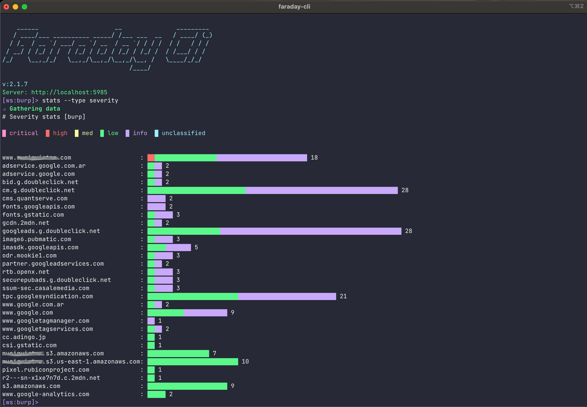

# Commands

All the commands can be run in ```Shell Mode``` (type `faraday-cli` and then the
command) or in ```Command Mode``` (`faraday-cli <command> ...`).

!!! tip "Getting help"
    * `faraday-cli --help` shows the common commands and examples.
    * `faraday-cli help -v` lists every command; `faraday-cli help <command>` or
      `faraday-cli <command> -h` shows a command's options
      (e.g. `faraday-cli scanners run -h`).

!!! info "Quoting arguments in Command Mode"
    Quote arguments the same way you would for any other CLI:

    ```
    $ faraday-cli tool run "nmap -sV www.example.com"
    $ faraday-cli host create -d '[{"ip": "10.0.0.1", "description": "web server"}]'
    $ faraday-cli scanners run --agent "First Scan" -w my_workspace
    ```

    The older escaped syntax shown in previous versions of these docs
    (`tool run \"nmap ...\"`, `-d \''[...]'\'`) is still accepted, so existing
    scripts keep working. You can also pass the whole command as a single
    string: `faraday-cli "workspace list"`.

### Command aliases

Some command groups can be typed with more than one name:

| Command | Also available as |
|---------|-------------------|
| `agent` (local Faraday Agents) | `agents`, `runner`, `runners` |
| `scanners` (cloud agents) | `scanner` |
| `faradai scan` | `pentest` |
| `faradai triage` | `triage` |
| `tool`, `workspace`, `host`, `service`, `vuln` | `tools`, `workspaces`, `hosts`, `services`, `vulns` |

## Authentication

### auth

Authenticate with your faraday server. Each login is saved as a named
**session** and becomes the active connection.

```
$ faraday-cli auth
Faraday url [http://localhost:5985]: http://localhost:5985
User: faraday
Password:
Saving config (session 'faraday@localhost')
✔ Authenticated with faraday: http://localhost:5985
```

If the user has 2FA enabled you will be asked for the OTP code.

*Optional arguments:*

| Syntax      | Description |
|:-----	|------:	|
| `-f/--faraday-url FARADAY_URL`       | url of your faraday server      |
| `-i/--ignore-ssl`   | Ignore SSL certificate validation        |
| `-u/--user USER`  | Faraday user       |
| `-p/--password PASSWORD`  | Faraday password       |
| `-n/--name NAME`  | Session name to save this connection as (default: `user@host`) |

!!! info "One active connection, multiple saved sessions"
    faraday-cli keeps **one active connection** at a time, but remembers the
    others as named *sessions* so you can switch between them instead of being
    logged in to two servers at once. Logging in with `auth` (and
    `faradai verify`/`login`, which save a `faradai-scan` session) adds a
    session and makes it active. Sessions are stored in `~/.faraday-cli.yml`
    (see [Settings](settings.md#configuration-file)).

### auth list

List the saved connection sessions (the active one is marked). Session names
default to `user@host`, so two users on the **same** server each get their own
switchable session instead of overwriting each other.

```
$ faraday-cli auth list
  ID  ACTIVE    NAME                          KIND    SERVER                              USER          WORKSPACE
----  --------  ----------------------------  ------  ----------------------------------  ------------  ------------
   1  ✔         alice@faraday.example.com     server  https://faraday.example.com/        alice         -
   2            bob@faraday.example.com       server  https://faraday.example.com/        bob           ws_b
   3            faradai-scan                  saas    https://scan.apps.faradaysec.com    you@corp.com  ext_corp_com
```

*Optional arguments:*

| Syntax      | Description |
|:-----	|------:	|
| `-p/--pretty`   | Show table in a pretty format       |

### auth use

Switch the active connection to a saved session — by its **ID number**, its
**name**, or its **user/email** (when unique). Every command (including
`pentest`/`triage`/`scanners`) then uses it.

```
$ faraday-cli auth use 3                 # by ID
$ faraday-cli auth use faradai-scan      # by name
$ faraday-cli auth use you@corp.com      # by user/email
Switched to 'faradai-scan' as you@corp.com (https://scan.apps.faradaysec.com) — workspace ext_corp_com
```

### auth rm

Remove a saved session (by ID, name or user). If it was the active one, you are
left without an active connection until you `auth use` another session or run
`auth` again.

```
$ faraday-cli auth rm 2
Removed 'bob@faraday.example.com'.
```

!!! info "Faraday token expiration"
    You may want to change the faraday token expiration time, so you don't have to authenticate so often.

    The default is 12 hours.

    To do it, change the value of ```api_token_expiration``` (expressed in seconds) in your faraday ```server.ini```


### status

Show the status of your current connection — the Faraday server, its version,
your user, whether the token is valid, the active workspace and the CLI
version. When you have more than one saved session, they are listed below.

```
$ faraday-cli status
FARADAY SERVER                IGNORE SSL    SERVER VERSION    USER     VALID TOKEN    WORKSPACE    CLI VERSION
----------------------------  ------------  ----------------  -------  -------------  -----------  -------------
https://faraday.example.com/  False         corp-5.25.0       alice    ✔              test         2.3.0

Saved sessions (switch with 'auth use <name>'):
  ID  ACTIVE    NAME                       KIND    SERVER                            USER          WORKSPACE
----  --------  -------------------------  ------  --------------------------------  ------------  ------------
   1  ✔         alice@faraday.example.com  server  https://faraday.example.com/      alice         test
   2            faradai-scan               saas    https://scan.apps.faradaysec.com  you@corp.com  ext_corp_com
```

If the server can't be reached or answers with an error, `status` shows the
reason (e.g. `Could not validate authentication: Server error (502)`) instead of
failing.

*Optional Arguments:*

| Syntax      | Description |
|:-----	|------:	|
| `-p/--pretty`   | Show table in a pretty format       |

## Workspaces

### workspace list

List workspaces created in faraday.

```
$ faraday-cli workspace list -p
+--------+---------+------------+---------+----------+----------+------------+
| NAME   |   HOSTS |   SERVICES | VULNS   | ACTIVE   | PUBLIC   | READONLY   |
|--------+---------+------------+---------+----------+----------+------------|
| test   |      13 |         13 | 39      | True     | False    | False      |
+--------+---------+------------+---------+----------+----------+------------+
```

*Optional Arguments:*

| Syntax      | Description |
|:-----	|------:	|
| `-j/--json-output`     | Show output in json     |
| `-p/--pretty`   | Show table in a pretty format       |
| `-i/--show-inactive`   | Include inactive (disabled) workspaces      |


### workspace get

Get details of a workspace.

```
$ faraday-cli workspace get -p test
+--------+----------+----------+------------+---------+------------+---------+
| NAME   | ACTIVE   | PUBLIC   | READONLY   |   HOSTS |   SERVICES |   VULNS |
|--------+----------+----------+------------+---------+------------+---------|
| test   | True     | False    | False      |      13 |         13 |      39 |
+--------+----------+----------+------------+---------+------------+---------+
```


*Required Arguments:*

| Syntax      | Description |
|:-----	|------:	|
| `WORKSPACE_NAME`      | Workspace name     |

*Optional Arguments:*

| Syntax      | Description |
|:-----	|------:	|
| `-j/--json-output`      | Show output in json     |
| `-p/--pretty`   | Show table in a pretty format       |

### workspace create

Create a new workspace in faraday. The new workspace becomes the active one
unless you pass `-d`.


```
$ faraday-cli workspace create test_workspace
✔ Created workspace: test_workspace
```

*Required Arguments:*

| Syntax      | Description |
|:-----	|------:	|
| `WORKSPACE_NAME`      | Workspace name     |

*Optional Arguments:*

| Syntax      | Description |
|:-----	|------:	|
| `-d/--dont-select`      | Don't select the workspace after creating it     |

### workspace select

Select your active workspace. Unless you use the ```-w``` argument, all the
commands will use this workspace. The active workspace is stored with the
active session and shown in the shell prompt (`[ws:test]>`).


```
$ faraday-cli workspace select test
✔ Selected workspace: test
```

*Required Arguments:*

| Syntax      | Description |
|:-----	|------:	|
| `WORKSPACE_NAME`      | Workspace name     |

### workspace delete

Delete workspace from faraday.

```
$ faraday-cli workspace delete test
Deleting workspace: test
Deleted workspace: test
```

*Required Arguments:*

| Syntax      | Description |
|:-----	|------:	|
| `WORKSPACE_NAME`     | Workspace name     |

### workspace disable

Disable (deactivate) a workspace. Disabled workspaces are hidden from
`workspace list` unless you pass `-i/--show-inactive`.

```
$ faraday-cli workspace disable test
```

*Required Arguments:*

| Syntax      | Description |
|:-----	|------:	|
| `WORKSPACE_NAME`     | Workspace name     |

### workspace enable

Enable (reactivate) a disabled workspace.

```
$ faraday-cli workspace enable test
```

*Required Arguments:*

| Syntax      | Description |
|:-----	|------:	|
| `WORKSPACE_NAME`     | Workspace name     |

### workspace dashboard

Show a dashboard with different information about the workspaces.


```
$ faraday-cli workspace dashboard
+--------------+----------------------------+---------------+--------------+------------------------------------------------------------------------------------------------+
| WORKSPACE    | INFO                       | SUMMARY       | SEVERITIES   | ACTIVITY                                                                                       |
+==============+============================+===============+==============+================================================================================================+
| faraday_test | users: -                   | hosts: 56     | critical: 0  | Nmap (shell) found 1 hosts, 7 services and 0 vulns (0/0/0/0/0) 2 hours ago by faraday          |
|              | readonly: False            | services: 221 | high: 0      | Openvas (report) found 13 hosts, 13 services and 39 vulns (0/0/13/26/0) 2 hours ago by faraday |
|              | public: False              | vulns: 52     | med: 13      | agent_firstcan (agent) found 42 hosts, 201 services and 13 vulns (0/0/0/2/11) 3 days ago       |
|              | updated: 06/17/21 15:45:55 |               | low: 28      |                                                                                                |
|              |                            |               | info: 11     |                                                                                                |
+--------------+----------------------------+---------------+--------------+------------------------------------------------------------------------------------------------+
```


## Hosts

### host list

List hosts in a workspace.


```
$ faraday-cli host list -p
+------+------------+---------+-------------+------------+---------+
|   ID | IP         | OS      | HOSTNAMES   |   SERVICES |   VULNS |
|------+------------+---------+-------------+------------+---------|
|   11 | 127.0.0.1  | unknown |             |          1 |       3 |
|    3 | 127.0.0.10 | unknown |             |          1 |       3 |
|    6 | 127.0.0.11 | unknown |             |          1 |       3 |
+------+------------+---------+-------------+------------+---------+
```

Use `-ip` to print only the IPs, one per line (handy to pipe into other tools):

```
$ faraday-cli host list -ip -w test | nmap -iL - -oX /tmp/nmap.xml
```

*Optional Arguments:*

| Syntax      | Description |
|:-----	|------:	|
| `-w/--workspace-name WORKSPACE_NAME`     | Workspace name    |
| `-p/--pretty`   | Show table in a pretty format       |
| `-j/--json-output`      | Show output in json     |
| `-ip/--show-ip`   | Show ip only      |

### host get

Get host information.


```
$ faraday-cli host get 13 -p
Host:
+------+-----------+---------+-------------+---------+---------+---------+
|   ID | IP        | OS      | HOSTNAMES   | OWNER   | OWNED   |   VULNS |
|------+-----------+---------+-------------+---------+---------+---------|
|   13 | 127.0.0.2 | unknown |             | faraday | False   |       3 |
+------+-----------+---------+-------------+---------+---------+---------+

Services:
+------+--------+---------------+------------+--------+-----------+----------+---------+
|   ID | NAME   | DESCRIPTION   | PROTOCOL   |   PORT | VERSION   | STATUS   |   VULNS |
|------+--------+---------------+------------+--------+-----------+----------+---------|
|   13 | ssh    |               | tcp        |     22 | unknown   | open     |       2 |
+------+--------+---------------+------------+--------+-----------+----------+---------+

Vulnerabilities:
+------+------------------------------------------+------------+----------+-------------+---------+
|   ID | NAME                                     | SEVERITY   | STATUS   | CONFIRMED   | TOOL    |
|------+------------------------------------------+------------+----------+-------------+---------|
|   37 | SSH Weak Encryption Algorithms Supported | MED        | opened   | False       | Openvas |
|   38 | SSH Weak MAC Algorithms Supported        | LOW        | opened   | False       | Openvas |
|   39 | TCP timestamps                           | LOW        | opened   | False       | Openvas |
+------+------------------------------------------+------------+----------+-------------+---------+
```

*Required Arguments:*

| Syntax      | Description |
|:-----	|------:	|
| `host_id`    | ID of the host    |

*Optional Arguments:*

| Syntax      | Description |
|:-----	|------:	|
| `-w/--workspace-name WORKSPACE_NAME`     | Workspace name    |
| `-p/--pretty`   | Show table in a pretty format       |
| `-j/--json-output`      | Show output in json     |

### host create

Create hosts from a JSON list.

```
$ faraday-cli host create -w test -d '[{"ip": "10.0.0.1", "description": "web server"}]'
Created host
```

!!! info
    You can pass the host data via stdin.
    ```
    $ echo '[{"ip": "1.1.1.5", "description": "some text"}]' | faraday-cli host create --stdin
    ```

*Optional Arguments:*

| Syntax      | Description |
|:-----	|------:	|
| `-w/--workspace-name WORKSPACE_NAME`     | Workspace name    |
| `-d/--host-data HOST_DATA`     | Host data in json format   |
| `--stdin`     | Read host-data from stdin   |
| `--resolve-hostname`     | Resolve the hostname of each host when it is created   |

*host data schema*:
```
{'type': 'array', 'items': {'type': 'object', 'properties':
    {'ip': {'type': 'string'}, 'description': {'type': 'string'},
    'hostnames': {'type': 'array'}}, 'required': ['ip', 'description']}}
```

### host delete

Delete host.


```
$ faraday-cli host delete 13
Host deleted
```

*Required Arguments:*

| Syntax      | Description |
|:-----	|------:	|
| `host_id`     | ID of the host    |

*Optional Arguments:*

| Syntax      | Description |
|:-----	|------:	|
| `-w/--workspace-name WORKSPACE_NAME`     | Workspace name    |

## Services

### service list

List services in a workspace.


```
$ faraday-cli service list -p
+------+--------+--------------+------------+--------+------------+--------+---------+
|   ID | NAME   | SUMMARY      | IP         |   PORT | PROTOCOL   |   HOST |   VULNS |
|------+--------+--------------+------------+--------+------------+--------+---------|
|    1 | ssh    | (22/tcp) ssh | 127.0.0.8  |     22 | tcp        |      1 |       2 |
|    2 | ssh    | (22/tcp) ssh | 127.0.0.3  |     22 | tcp        |      2 |       2 |
|    3 | ssh    | (22/tcp) ssh | 127.0.0.10 |     22 | tcp        |      3 |       2 |
+------+--------+--------------+------------+--------+------------+--------+---------+
```


*Optional Arguments:*

| Syntax      | Description |
|:-----	|------:	|
| `-w/--workspace-name WORKSPACE_NAME`     | Workspace name    |
| `-p/--pretty`   | Show table in a pretty format       |
| `-j/--json-output`      | Show output in json     |

## Vulnerabilities

### vuln list

List vulnerabilities from a workspace, 50 per page by default. In interactive
mode you can move between pages with `+` (next), `-` (previous) and `q` (exit).


```
$ faraday-cli vuln list -p
+------+-----------------------------------------------------------------------------+------------+----------+-------------+--------------------------------------------------+-------------+
|   ID | NAME                                                                        | SEVERITY   | STATUS   | CONFIRMED   | ASSET                                            | HOSTNAMES   |
|------+-----------------------------------------------------------------------------+------------+----------+-------------+--------------------------------------------------+-------------|
| 5200 | Terminal Services Encryption Level is Medium or Low                         | med        | opened   | False       | 10.33.112.22 [Service - (3389/tcp) msrdp]        | qa3app02    |
| 5198 | Microsoft Windows Remote Desktop Protocol Server Man-in-the-Middle Weakness | med        | opened   | False       | 10.33.112.22 [Service - (3389/tcp) msrdp]        | qa3app02    |
| 5120 | SMB Signing Disabled                                                        | med        | opened   | False       | 10.33.112.24 [Service - (445/tcp) cifs]          | qa3app04    |
| 5272 | Ethernet Card Manufacturer Detection                                        | info       | opened   | False       | 10.33.112.21 [Host - ID:72]                      | qa3app01    |
+------+-----------------------------------------------------------------------------+------------+----------+-------------+--------------------------------------------------+-------------+
[Next Page: '+', Previous Page: '-', Exit: 'q']
```


*Optional Arguments:*

| Syntax              | Description |
|:--------------------|------------:|
| `-w/--workspace-name WORKSPACE_NAME` | Workspace name |
| `-p/--pretty`       | Show table in a pretty format |
| `-j/--json-output`  | Show output in json |
| `--severity [SEVERITY ...]` | Filter by severity: informational/critical/high/medium/low/unclassified |
| `--confirmed`       | Show only confirmed vulnerabilities |
| `--ignore-info`     | Ignore informational/unclassified vulnerabilities |
| `--page PAGE`       | Page number to display, starting from 0 |
| `--limit LIMIT`     | Number of vulnerabilities per page (default 50, max 4000) |
| `--no-interaction`  | Don't ask for page navigation (useful in scripts) |
| `--advanced-filters FILTER` | Apply complex filters using a JSON structure, e.g. `--advanced-filters '{"filters":[{"name":"description","op":"like","val":"%sql injection%"}]}'` |


### vuln update

Update one or more fields of a vulnerability.

```
$ faraday-cli vuln update 46 -w test --status closed
Vulnerability updated
```

*Required Arguments:*

| Syntax      | Description |
|:-----	|------:	|
| `vulnerability_id`   | ID of the vulnerability       |

*Optional Arguments:*

| Syntax                  | Description |
|:------------------------|------------:|
| `-w/--workspace-name WORKSPACE_NAME` | Workspace name |
| `--status STATUS`       | Status of the Vulnerability: open, closed, re-opened, risk-accepted |
| `--severity SEVERITY`   | Severity of the Vulnerability: unclassified, info, low, med, high, critical |
| `--desc DESCRIPTION`    | Description |
| `--name NAME`           | Vulnerability Name |
| `--tag TAG`             | Tag to add to the vuln (repeat it to add more than one) |
| `--confirmed CONFIRMED` | Indicates if the Vulnerability is confirmed: True, False |

### vuln delete

Delete a vulnerability.

```
$ faraday-cli vuln delete 46 -w test
Vulnerability deleted
```

*Required Arguments:*

| Syntax      | Description |
|:-----	|------:	|
| `vuln_id`   | ID of the vulnerability       |

*Optional Arguments:*

| Syntax                  | Description    |
|:------------------------|----------------|
| `-w/--workspace-name WORKSPACE_NAME` | Workspace name |

### vuln add-evidence

Add an image evidence to a vulnerability.

```
$ faraday-cli vuln add-evidence -id 46 -w test ~/evidence.png
Evidence upload was successful
```

*Required Arguments:*

| Syntax      | Description |
|:-----	|------:	|
| `-id/--vulnerability-id VULNERABILITY_ID`   | ID of the vulnerability       |
| `image`      | Image path     |


*Optional Arguments:*

| Syntax      | Description |
|:-----	|------:	|
| `-w/--workspace-name WORKSPACE_NAME`     | Workspace name    |

## Tools and Reports

### tool report

Process different tools reports and upload the information into faraday.

!!! info
    Check our [Faraday Plugins](https://github.com/infobyte/faraday_plugins) repo for information about compatible tools.


```
$ faraday-cli tool report $HOME/Downloads/openvas-report.xml
📄 Processing Openvas report
⬆ Sending data to workspace: test
✔ Done
```

*Required Arguments:*

| Syntax      | Description |
|:-----	|------:	|
| `report_path`     | Path of the report file    |

*Optional Arguments:*

| Syntax                   | Description |
|:-------------------------|------:	|
| `-w/--workspace-name WORKSPACE_NAME`      | Workspace name    |
| `--create-workspace`     | If the workspace given with `-w` doesn't exist, create it    |
| `--plugin-id PLUGIN_ID`  | Plugin ID (force detection)       |
| `-j/--json-output`       | Show output in json (don't send it to faraday)       |
| `--vuln-tag VULN_TAG`    | Tag to add to vulnerabilities (repeatable)      |
| `--host-tag HOST_TAG`    | Tag to add to hosts (repeatable)      |
| `--service-tag SERVICE_TAG` | Tag to add to services (repeatable)     |
| `--min-severity SEVERITY` | Minimum severity of vulnerabilities to import (unclassified/info/low/med/high/critical)      |
| `--max-severity SEVERITY` | Maximum severity of vulnerabilities to import (unclassified/info/low/med/high/critical)      |

### tool run

Execute a tool and upload the information into faraday. Quote the whole tool
command so it reaches faraday-cli as a single argument.

!!! info
    Check our [Faraday Plugins](https://github.com/infobyte/faraday_plugins) repo for information about compatible tools.


```
$ faraday-cli tool run "nmap www.exampledomain.com"
💻 Processing Nmap command
Starting Nmap 7.80 ( https://nmap.org ) at 2021-02-22 14:13 -03
Nmap scan report for www.exampledomain.com (10.196.205.130)
Host is up (0.17s latency).
rDNS record for 10.196.205.130: 10.196.205.130.bc.googleusercontent.com
Not shown: 996 filtered ports
PORT     STATE  SERVICE
80/tcp   open   http
443/tcp  open   https
2222/tcp open   EtherNetIP-1
3306/tcp closed mysql

Nmap done: 1 IP address (1 host up) scanned in 11.12 seconds
⬆ Sending data to workspace: test
✔ Done
```

*Required Arguments:*

| Syntax      | Description |
|:-----	|------:	|
| `command`     | Command of the tool to process    |

*Optional Arguments:*

| Syntax      | Description |
|:-----	|------:	|
| `-w/--workspace-name WORKSPACE_NAME`     | Workspace name    |
| `--create-workspace`     | If the workspace given with `-w` doesn't exist, create it    |
| `--plugin-id PLUGIN_ID`   | Plugin ID (force detection)       |
| `-j/--json-output`   | Show output in json (don't send it to faraday)       |
| `--vuln-tag VULN_TAG`    | Tag to add to vulnerabilities (repeatable)      |
| `--host-tag HOST_TAG`    | Tag to add to hosts (repeatable)      |
| `--service-tag SERVICE_TAG` | Tag to add to services (repeatable)     |
| `--min-severity SEVERITY` | Minimum severity of vulnerabilities to import (unclassified/info/low/med/high/critical)      |
| `--max-severity SEVERITY` | Maximum severity of vulnerabilities to import (unclassified/info/low/med/high/critical)      |
| `--force`   | Process the output of the command regardless of its result       |

## Vulnerability Stats

### stats

Different stats about the vulnerabilities in Faraday.




```
$ faraday-cli stats --type severity -w test
```

*Required Arguments:*

| Syntax                         | Description |
|:-------------------------------|------:	|
| `--type {severity,vulns,date}` | Type of stat    |

*Optional Arguments:*

| Syntax      | Description |
|:-----	|------:	|
| `-w/--workspace-name WORKSPACE_NAME`     | Workspace name    |
| `--ignore-info`   | Ignore informational/unclassified vulnerabilities       |
| `--severity [SEVERITY ...]`      | Filter by severity: informational/critical/high/medium/low/unclassified     |
| `--confirmed`   | Confirmed vulnerabilities       |


## Agents

!!! info
    For these commands you need to have our [Faraday Agents](https://github.com/infobyte/faraday_agent_dispatcher) configured.

!!! note "`runner` / `runners` alias"
    Faraday Agents (the local dispatcher runners) are also reachable as
    **`runner`/`runners`** (and `agents`) — `runners list`, `runners get`,
    `runners run` are synonyms for the `agent` commands below. The
    server-side scanners live under the separate [`scanners`](#scanners-cloud-agents)
    group.

### agent list

List all configured agents.


```
$ faraday-cli agent list
  ID  NAME    ACTIVE    STATUS    EXECUTORS
----  ------  --------  --------  -----------
   2  nico    True      online    nmap
```


*Optional Arguments:*

| Syntax      | Description |
|:-----	|------:	|
| `-p/--pretty`   | Show table in a pretty format       |
| `-j/--json-output`      | Show output in json     |

### agent get

Get information of an agent and its executors.


```
$ faraday-cli agent get 2
   ID  NAME    ACTIVE    STATUS
----  ------  --------  --------
   2  nico    True      online

Executors:
  ID  NAME    PARAMETERS [REQUIRED]
----  ------  -----------------------
   2  nmap    target [True]
              option_pn [False]
              option_sc [False]
              option_sv [False]
              port_list [False]
              top_ports [False]
              host_timeout [False]
              script_timeout [False]
```

*Required Arguments:*

| Syntax      | Description |
|:-----	|------:	|
| `AGENT_ID`     | ID of the Agent    |

*Optional Arguments:*

| Syntax      | Description |
|:-----	|------:	|
| `-p/--pretty`   | Show table in a pretty format       |
| `-j/--json-output`      | Show output in json     |

### agent run

Run an executor.

```
$ faraday-cli agent run -a 1 -e nmap -w my_workspace -p '{"target": "www.google.com"}'
Running executor: unnamed_agent/nmap
Parameters: {"TARGET": "www.google.com"}
Generated Command: 13
```

!!! info
    You can pass the executor parameters via stdin.
    ```
    $ echo '{"target": "www.google.com"}' | faraday-cli agent run -a 1 -e nmap --stdin --workspace-name my_workspace
    ```
    If no ```-p``` or ```--stdin``` argument is provided, then the executor parameters will be asked one by one.

    You can store the parameters in env variables and will be auto loaded.

    Example:
    ```
    For the TARGET parameter of the NMAP executor save the variable FARADAY_CLI_EXECUTOR_NMAP_TARGET
    ```

    You can store the parameters in a file and use it as a 'profile' to repeat scans
    ```
    $ cat scan_test.com_nmap.vars
    FARADAY_CLI_EXECUTOR_NMAP_TARGET=test.com
    FARADAY_CLI_EXECUTOR_NMAP_OPTION_PN=true
    FARADAY_CLI_EXECUTOR_NMAP_OPTION_SC=false
    FARADAY_CLI_EXECUTOR_NMAP_OPTION_SV=true
    FARADAY_CLI_EXECUTOR_NMAP_PORT_LIST=
    FARADAY_CLI_EXECUTOR_NMAP_TOP_PORTS=
    FARADAY_CLI_EXECUTOR_NMAP_HOST_TIMEOUT=
    FARADAY_CLI_EXECUTOR_NMAP_SCRIPT_TIMEOUT=

    $ source scan_test.com_nmap.vars && faraday-cli agent run -a 2 -e nmap -w test
    Running executor: unnamed_agent/nmap
    Parameters: {"TARGET": "test.com", "OPTION_PN": "true", "OPTION_SC": "false", "OPTION_SV": "true"}
    Generated Command: 14
    ```

*Required Arguments:*

| Syntax                                 | Description |
|:---------------------------------------|------:	|
| `-a/--agent-id AGENT_ID`               | ID of the agent    |
| `-e/--executor-name EXECUTOR_NAME`     | Executor name   |

*Optional Arguments:*

| Syntax      | Description |
|:-----	|------:	|
| `-p/--executor-params EXECUTOR_PARAMS` | Executor params in json (otherwise read from `--stdin`, env variables or asked one by one) |
| `--stdin`   | Read executor-params from stdin       |
| `-w/--workspace-name WORKSPACE_NAME`   | Workspace name (default: the active workspace)    |
| `--vuln-tag VULN_TAG`    | Tag to add to vulnerabilities       |
| `--host-tag HOST_TAG`    | Tag to add to hosts       |
| `--service-tag SERVICE_TAG` | Tag to add to services      |
| `--min-severity SEVERITY` | Minimum severity of vulnerabilities to import (unclassified/info/low/med/high/critical)      |
| `--max-severity SEVERITY` | Maximum severity of vulnerabilities to import (unclassified/info/low/med/high/critical)      |


## Scanners (cloud agents)

!!! info
    **Scanners** are Faraday **cloud agents** (the `v3/cloud_agents` API) — the
    server-side security agents, distinct from the local Faraday Agents /
    `runners` above. This is the generic group: list any cloud agent and run it
    with its own parameters. FaradAI is one such scanner, so it can be
    launched here (`scanners run faradai ...`) **or** via its own
    richer [`faradai`](#faradai) command. `scanner` is an alias of `scanners`.

### scanners list

List the cloud agents (scanners) available on the server.

```
$ faraday-cli scanners list
  ID  NAME                SLUG        CATEGORY    LAST_RUN
----  ------------------  ----------  ----------  --------------------------------
   7  FaradAI             faradai     AI Pentest  2026-10-16T19:52:07.004347+00:00
   6  New CVEs Detection  top-10-cve  discovery   2026-10-16T12:47:49.051544+00:00
```

*Optional Arguments:*

| Syntax         | Description                   |
|-------------------|-------------------------------|
| `-j/--json-output` | Show output in json       |
| `-p/--pretty`  | Show table in a pretty format |

### scanners get

Show a single cloud agent and the parameters it accepts (useful before
`scanners run` so you know which `--param` keys to pass).

```
$ faraday-cli scanners get 7
  ID  NAME     SLUG     CATEGORY    LAST_RUN
----  -------  -------  ----------  --------------------------------
   7  FaradAI  faradai  AI Pentest  2026-10-16T19:52:07.004347+00:00

Parameters (pass with --param KEY=VALUE):
PARAM               REQUIRED    TYPE/DESC    DEFAULT
------------------  ----------  -----------  ----------------------
GOAL                            string       Open ports
MODE                            string       claude
ROUNDS                          integer      1
TARGET              yes         string       example.com
INSTRUCTION         yes         string       Are there any open port?
TIME_LIMIT_SECONDS              integer      111
```

The `DEFAULT` column shows the values stored on the agent.

*Required Arguments:*

| Syntax         | Description                   |
|-------------------|-------------------------------|
| `scanner_id`      | ID of the cloud agent |

*Optional Arguments:*

| Syntax         | Description                   |
|-------------------|-------------------------------|
| `-j/--json-output` | Show output in json       |
| `-p/--pretty`  | Show table in a pretty format |

### scanners run

Launch **any** cloud agent against one or more workspaces with its
parameters. The agent is selected by id or by a name/slug fragment, given
positionally or with `-a`.

```
$ faraday-cli scanners run faradai -w my_workspace \
    --param TARGET=https://example.com --param ROUNDS=20
Launching cloud agent faradai
  Workspaces: my_workspace
  Params:     {'TARGET': 'https://example.com', 'ROUNDS': 20}
Run launched. Command id(s): 158
Reproduce this run with:
  faraday-cli scanners run --agent faradai -w my_workspace --param TARGET=https://example.com --param ROUNDS=20
```

```
# equivalent, params as a JSON object
$ faraday-cli scanners run -a 7 -w my_workspace \
    --params-json '{"TARGET": "https://example.com", "MODE": "Dual", "ROUNDS": 20}'
```

**Guided mode (wizard):** if you don't pass any parameter on an interactive
terminal (or you pass `--wizard`), the CLI lists the agent's parameters and asks
for each one, pre-filling the values stored on the agent. Before launching it
shows the final parameters and asks for confirmation (default **No**), and
afterwards it prints a one-liner to repeat the run without prompts.

```
$ faraday-cli scanners run faradai -w my_workspace

Parameters for faradai (Enter = keep default/skip):
  GOAL — string
    GOAL [Open ports]:
  TARGET [required] — string
    TARGET [example.com]: https://app.example.com
  ...
Launching cloud agent faradai
  Workspaces: my_workspace
  Params:     {'GOAL': 'Open ports', 'TARGET': 'https://app.example.com', ...}
Launch this run? [y/N]: y
Run launched. Command id(s): 159
```

Without a terminal (scripts, CI), no questions are asked: pass the
parameters with `--param`/`--params-json`.

*Arguments:*

| Syntax            | Description                                             |
|----------------------|---------------------------------------------------------|
| `AGENT` / `-a/--agent AGENT` | Cloud-agent id or name/slug fragment (e.g. `7`, `faradai`, `"First Scan"`). Required, positionally or with `-a` |
| `-w/--workspace WORKSPACE`  | Workspace name (repeatable) |
| `--param KEY=VALUE`  | Run parameter (repeatable). Bare integers and `true`/`false` are converted. |
| `--params-json PARAMS_JSON` | All run params as one JSON object (alternative to repeated `--param`) |
| `--wizard`           | Ask for the parameters interactively, even if `--param` was given |
| `--watch`            | Poll the launched command(s) until they finish          |

!!! info "Which workspace is used"
    The run goes to: the `-w` workspace(s) → a workspace passed as a parameter
    (e.g. `--param WORKSPACES=ws`, used by FaradAI Triage) → the active workspace
    → on a terminal, you are asked (pre-filled with the agent's default). If none
    can be resolved, the CLI asks you to pass `--workspace`.

!!! warning "Only executor inputs go in `--param`"
    A cloud agent has two kinds of fields: its executor **run inputs** (e.g.
    First Scan's `targets`, FaradAI's `TARGET`) and its **stored configuration**
    (`resolve_hostname`, `ignore_info`, tags, default workspaces…). Only run
    inputs may be passed with `--param` — configuration is set on the agent
    itself in the Faraday web UI. The CLI validates your `--param` keys against
    the agent's input schema before launching and lists the accepted keys on a
    mismatch (`scanners get <id>` shows them too).

!!! info "`--watch`"
    After launching, `--watch` polls the workspace's command list every ~15s and
    prints each command as it finishes, then `Run finished.`. Press Ctrl-C to stop
    watching — the run keeps going server-side. Some cloud agents keep their
    command "In progress" on the server after the scan is done; in that case
    check the results in the Faraday web UI and stop watching with Ctrl-C.

## FaradAI

!!! info
    FaradAI is a Faraday **cloud agent** (a [scanner](#scanners-cloud-agents)),
    with its own command for the common cases: tiered scans, triage, and the
    FaradAI-scan SaaS onboarding. To list cloud agents use
    [`scanners list`](#scanners-list); to run FaradAI with raw parameters use
    [`scanners run faradai`](#scanners-run).

!!! tip "Shortcuts"
    The two common actions have top-level shortcuts: **`faraday-cli pentest`**
    (= `faradai scan`) and **`faraday-cli triage`** (= `faradai triage`). All
    the flags below apply to the shortcut too.

!!! note "Which server is used"
    `faradai scan` / `faradai triage` run against your **active connection**
    (see [`auth`](#authentication)) — your Faraday server, or the FaradAI-scan
    SaaS if you switched to its session with `auth use faradai-scan`.

    * If you have saved sessions but none is active, the CLI asks you to pick
      one with `auth use <id|name>`.
    * If nothing is configured at all, the first `pentest`/`triage` on a
      terminal walks you through creating a FaradAI-scan SaaS account (see
      [below](#faradai-scan-saas-register-verify-login)). Without a terminal
      (scripts, CI) it fails and tells you to run `auth` or `faradai login`.
    * `--standalone` is **deprecated**: it switches the active connection to the
      `faradai-scan` session for the run. Prefer `auth use faradai-scan`.

!!! warning "Register with an email on the domain you're scanning"
    A self-registered SaaS account is scoped to `ext_<your-email-domain>` and can
    only scan that domain and its subdomains. Registering `you@gmail.com` (or any
    public provider, or another company's domain) to scan `faradaysec.com` will
    be rejected — public providers get no scan scope at all. During the guided
    onboarding the CLI checks your email against the `--target` and, if they
    don't match, stops **before** sending the code (no account is created). An
    already-registered account is checked the same way before a scan launches
    (`Out of scope: …`). Use an email at the target's domain, or have an operator
    authorize the target and re-run with `--skip-scope-check` (the server still
    enforces scope).

### faradai scan

Launch a FaradAI pentest against a target. The FaradAI cloud agent is
auto-discovered by name/slug; pass `--agent-id` to select it explicitly.

```
# shortcut
$ faraday-cli pentest --target https://example.com

# full form
$ faraday-cli faradai scan --target https://example.com --workspace my_workspace
Launching FaradAI scan
  Target:     https://example.com
  Mode:       Dual
  Rounds:     20 (standard)
  Workspaces: my_workspace
Scan launched. Command id(s): 151
```

```
$ faraday-cli faradai scan --target https://example.com -w my_workspace --advanced --watch
```

| Parameter            | Description                                             |
|----------------------|---------------------------------------------------------|
| `--target TARGET`    | URL/host to scan (required)                             |
| `-w/--workspace WORKSPACE` | Workspace name (repeatable); see below for the default |
| `--instruction INSTRUCTION` | Pentest instruction (default: the FaradAI wizard's staged template for the tier — standard or advanced) |
| `--goal GOAL`        | Free-text goal/focus for the run (default: the wizard's GOAL for the tier) |
| `--mode {Dual,Claude,Codex}` | Execution mode (default: `Dual`)               |
| `--rounds ROUNDS`    | Max agent rounds (default: **20** standard; **80** with `--advanced`). Explicit `--rounds` overrides the count but not the template. |
| `--advanced`         | Advanced (deeper) scan — 80 rounds + the wizard full-audit instruction, instead of the standard 20 |
| `--agent-id AGENT_ID` | Explicit cloud-agent id (skips FaradAI auto-discovery)  |
| `--watch`            | Poll the launched command(s) until they finish ([see `--watch`](#scanners-run)) |
| `--skip-scope-check` | Skip the client-side target-vs-`ext_<domain>` workspace pre-check (operator-authorized workspaces; the server still enforces scope) |
| `--standalone`       | (deprecated) Switch to the `faradai-scan` session for the run; prefer `auth use faradai-scan` |

!!! tip "Workspace"
    You rarely need `--workspace` for a scan: without it the active workspace is
    used, and when there is none and you have access to exactly one workspace
    (the usual case for a SaaS scan user), that one is used. Pass `--workspace`
    when you can access several.

!!! note "Instructions match the web wizard"
    `faradai scan` (standard/advanced) and `faradai triage` launch with the
    same staged instruction templates the FaradAI web wizard sends — standard →
    *standard*, `--advanced` → *full-audit*, triage → *triage*. Override with
    `--instruction` for a custom run.

### faradai triage

Run a FaradAI **triage** over the existing findings of one or more workspaces
(re-test/reproduce, enrich, optionally auto-close false positives). This targets
the separate *FaradAI Triage* cloud agent (auto-discovered); triage has no
`--target` — it works over the `--workspace` findings, not a URL. If none of the
workspaces has findings, it refuses to launch (unless you pass `--dry-run`).

```
# shortcut
$ faraday-cli triage --workspace my_workspace --severities critical,high --reproduce

# full form
$ faraday-cli faradai triage --workspace my_workspace --severities critical,high --reproduce
```

| Parameter            | Description                                             |
|----------------------|---------------------------------------------------------|
| `-w/--workspace WORKSPACE` | Workspace to triage (repeatable, at least one required) |
| `--severities SEVERITIES` | Comma-separated severities (e.g. `critical,high,medium`) |
| `--confirmed-only`   | Only triage findings already marked confirmed           |
| `--auto-close-fp`    | Auto-close findings determined to be false positives    |
| `--target-filter TARGET_FILTER` | Only triage findings matching this target/host filter |
| `--reproduce`        | Actively re-test (reproduce) each finding against the live target |
| `--batch-size BATCH_SIZE` | Findings per triage batch                          |
| `--rounds ROUNDS`    | Max agent rounds                                        |
| `--goal GOAL`        | Free-text goal for the triage run                       |
| `--instruction INSTRUCTION` | Triage instruction (default: the wizard's staged triage template) |
| `--agent-id AGENT_ID` | Explicit cloud-agent id (skips auto-discovery)          |
| `--watch`            | Poll the launched command(s) until they finish          |
| `--standalone`       | (deprecated) Switch to the `faradai-scan` session for the run |
| `--dry-run`          | Ask the agent to plan without changing findings         |

### FaradAI-scan SaaS (register / verify / login)

!!! info
    The FaradAI-scan SaaS (`https://faradai-scan.apps.faradaysec.com`) lets you
    self-register from the CLI — no Faraday web UI. New accounts get one free
    scan per tier; further scans need purchased credits.

Zero-to-scan flow:

```
$ faraday-cli faradai register --email you@corp.com
Verification code sent to you@corp.com.
Generated password: ****************  (save it — you'll log in with it later)
Run: faradai verify <code>

$ faraday-cli faradai verify 123456
FaradAI scan account ready — active connection is now 'faradai-scan' (you@corp.com).

$ faraday-cli pentest --target https://corp.com
```

Or skip straight to scanning — with nothing configured, the first
`pentest`/`faradai scan` on a terminal walks you through register + verify
inline, then runs:

```
$ faraday-cli pentest --target https://corp.com
No FaradAI-scan account yet — let's create one.
Email: you@corp.com
Verification code sent to you@corp.com.
Generated password: ****************  (save it — you'll log in with it later)
Verification code (check your email): 123456
Launching FaradAI scan ...
```

`register` keeps the email + password until you verify, so `verify` needs only
the code. Pass `--password` to choose your own; omit it and one is generated for
you and printed once (save it — it's what you log in with later). Returning
users re-authenticate without a new code:

```
$ faraday-cli faradai login --email you@corp.com
Password:
Logged in to https://scan.apps.faradaysec.com — active connection is now 'faradai-scan'. Workspace: ext_corp_com
```

`verify` and `login` save the SaaS connection as the **`faradai-scan`
session** and make it the active connection, so every command (pentest,
triage, scanners, vuln, …) runs against the SaaS until you switch back with
`auth use <name>`. They also store your `ext_<domain>` workspace, so later scans
need only `--target`. The pending email/password are removed from the config
once `verify` succeeds (or when the server says there is no pending
registration).

| Command           | Parameters                                                      |
|-------------------|-----------------------------------------------------------------|
| `faradai register`| `--email` (required), `--password`, `--dashboard-url`           |
| `faradai verify`  | `CODE` (positional, or `--code`; required), `--email` and `--password` (default: the pending registration), `--dashboard-url` (default: the one used by `register`) |
| `faradai login`   | `--email` (required), `--password` (asked if omitted), `--scan-url` |


## Executive Reports

!!! info
    These commands only work with a commercial version of [Faraday](https://www.faradaysec.com).

### executive_report list-templates

List the templates available to generate Executive Reports.


```
$ faraday-cli executive_report list-templates -p
+------------------------------------------------------------------+-----------+
| NAME                                                             | GROUPED   |
|------------------------------------------------------------------+-----------|
| generic_default.docx (generic) (Word)                            | False     |
| generic_default.html (generic) (PDF)                             | False     |
| group_default.docx (grouped) (Word)                              | True      |
| group_default.html (grouped) (PDF)                               | True      |
+------------------------------------------------------------------+-----------+
```


*Optional Arguments:*

| Syntax      | Description |
|:-----	|------:	|
| `-w/--workspace-name WORKSPACE_NAME`     | Workspace name    |
| `-p/--pretty`   | Show table in a pretty format       |

### executive_report create

Generate an executive report with a given template.

```
$ faraday-cli executive_report create -t "generic_default.html (generic) (PDF)" --title title --summary summary --enterprise company -d /tmp/test.pdf --ignore-info
Report created: /tmp/test.pdf
```

*Optional Arguments:*

| Syntax      | Description |
|:-----	|------:	|
| `-w/--workspaces-names WORKSPACE_NAME`     | Workspace name    |
| `-t/--template TEMPLATE`   | Template (see `list-templates`)       |
| `--title TITLE`   | Report title       |
| `--summary SUMMARY`   | Report summary      |
| `--recommendations RECOMMENDATIONS`   | Report recommendations      |
| `--conclusions CONCLUSIONS`   | Report conclusions      |
| `--scope SCOPE`   | Report scope      |
| `--objectives OBJECTIVES`   | Report objectives      |
| `--enterprise ENTERPRISE`   | Enterprise name      |
| `--confirmed`   | Confirmed vulnerabilities      |
| `--severity [SEVERITY ...]`   | Filter by severity: informational/critical/high/medium/low/unclassified      |
| `--ignore-info`   | Ignore informational/unclassified vulnerabilities     |
| `-d/--destination DESTINATION`   | Report destination      |


## Interactive shell features

When you run `faraday-cli` with no arguments you get an interactive shell
(`Faraday>`, or `[ws:<workspace>]>` once a workspace is selected) with command
history, tab completion and these extras:

### Auto-command detection

Anything you type that isn't a faraday-cli command is run as an OS command. If
`auto_command_detection` is enabled (the default) and the command belongs to a
tool supported by [Faraday Plugins](https://github.com/infobyte/faraday_plugins)
(e.g. `nmap`, `ping`), its output is also processed and uploaded to the active
workspace:

```
[ws:test]> nmap 10.0.0.1
💻 Processing Nmap command
...
⬆ Sending data to workspace: test
✔ Done
```

If there is no active workspace the command just runs. Turn it off with
`set auto_command_detection false` to run OS commands without processing them.
The same detection applies in command mode (`faraday-cli nmap 10.0.0.1`); use
[`tool run`](#tool-run) to choose the workspace, tags or plugin explicitly.

### cd

Change the current working directory of the shell (`cd` alone goes to your home).

```
[ws:test]> cd /tmp
```

### Update notifications

On startup, faraday-cli checks PyPI and shows a message when a newer version is
available; `status` shows it too in the `CLI VERSION` column.

```
A new version of faraday-cli (2.3.1) is available!!
```

## Core commands

### help

Using the help command you can get info of any command.

```
$ faraday-cli help -v

Documented commands (use 'help -v' for verbose/'help <topic>' for details):

Core
------------------------------------------------------------------------------------------------------
auth                  Authenticate with a faraday server (or manage sessions: list/use/rm)
exit                  exit the application. Shorthand: Ctrl-D.
status                Show Cli status
version               Faraday cli version

Objects
------------------------------------------------------------------------------------------------------
agent                 agent actions
executive_report      executive_report actions
faradai               faradai actions
host                  host actions
scanners              scanners (cloud agent) actions
service               service actions
tool                  tool actions
vuln                  vulnerabilities actions
workspace             workspace actions

Stats
------------------------------------------------------------------------------------------------------
stats                 Different statistics about the information on Faraday
...
```

```
$ faraday-cli help auth
usage: auth [-h] [-f FARADAY_URL] [-i] [-u USER] [-p PASSWORD] [-n NAME]
            {list,rm,use} ...

Authenticate with a faraday server (or manage sessions: list/use/rm)

options:
  -h, --help            show this help message and exit
  -f, --faraday-url FARADAY_URL
                        Faraday server URL
  -i, --ignore-ssl      Ignore SSL verification
  -u, --user USER       Faraday user
  -p, --password PASSWORD
                        Faraday password
  -n, --name NAME       Session name to save this connection as (default:
                        user@host)

action:
  {list,rm,use}
    list                list saved connection sessions
    rm                  remove a saved connection session
    use                 switch the active connection
```

The same help is available as `faraday-cli <command> -h`, also for
subcommands (`faraday-cli auth list -h`).

### version

Show the faraday-cli version.

```
$ faraday-cli version
faraday-cli: 2.3.0
```

### set

List or change the CLI settings. See [Settings](settings.md).

```
$ faraday-cli set ignore_info_severity true
ignore_info_severity - was: False
now: True
```

### history

In shell mode, list, re-run, edit or save the commands you typed before (they
are kept in `~/.faraday-cli_history`).

```
[ws:test]> history
    1  workspace select test
    2  vuln list --severity critical
[ws:test]> history -r 2
```

### exit / quit

Exit the interactive shell (also `Ctrl-D`).
